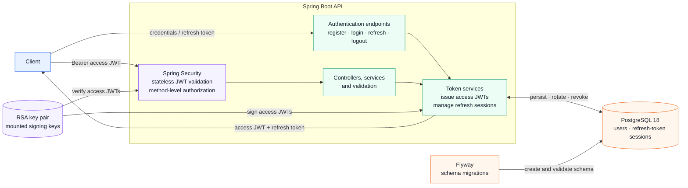

# AuthPOC

AuthPOC is an authentication-service proof of concept built around secure software delivery. The project is deliberately
focused on the fundamentals that must be reliable before a service is deployed: authentication design, dependency
governance, repeatable builds, database migration discipline, container isolation, and CI security verification.

## 1. Project Overview & Philosophy

The POC applies those principles to:

- secure access-token authentication and authorization;
- short-lived access tokens with revocable refresh-token sessions;
- dependency and supply-chain monitoring with Dependabot, image digest pinning, and vulnerability scanning;
- database migrations that are validated against the real PostgreSQL dialect; and
- containerized execution using a digest-pinned base image.

This is not a complete identity platform or a production deployment blueprint. It is a bounded learning project for
practicing the engineering controls that support secure software delivery.

Deployment automation, including Continuous Deployment (CD), and cloud provisioning are future work. For now, the
project focuses on build-time CI verification, test quality, dependency and image auditing, and local containerization.

### Simplified architecture



Access-token authentication does not require a database lookup for each bearer request. Refresh-token creation,
rotation, revocation, and reuse detection do use persistent server-side state in PostgreSQL.

## 2. Technology Stack & Architecture

### Core stack

| Area                  | Technology                                      |
|-----------------------|-------------------------------------------------|
| Runtime               | Java 21                                         |
| Application framework | Spring Boot 4.1.2                               |
| Web/API               | Spring MVC with Bean Validation                 |
| Security              | Spring Security OAuth2 Resource Server with JWT |
| Persistence           | Spring Data JPA / Hibernate                     |
| Database              | PostgreSQL 18                                   |
| Schema management     | Flyway                                          |
| Build                 | Maven Wrapper                                   |
| API documentation     | Springdoc OpenAPI / Swagger UI                  |
| Runtime packaging     | Docker and Docker Compose                       |

### Service boundaries

The service uses stateless access-token authentication, with refresh-token sessions managed through persistent
server-side storage in PostgreSQL:

1. Authentication endpoints register users, authenticate credentials, issue tokens, refresh sessions, and revoke
   refresh-token families.
2. Protected user endpoints authorize requests using bearer JWTs and method-level authorities.
3. Administrative endpoints provide permission-controlled user management.
4. Flyway owns schema creation and migration history; Hibernate validates the integration-test schema rather than
   silently changing it.

The authentication model intentionally uses two token types:

- **Access token:** a short-lived, RSA-signed JWT used on API requests. The default configuration gives it a 30-second
  lifetime, limiting the window in which a stolen bearer token can be used.
- **Refresh token:** a persistent server-side session token stored in PostgreSQL with a default seven-day lifetime.
  Refresh tokens rotate within a token family, and replay of a revoked token triggers family revocation. This supports
  logout, expiration, reuse detection, and account-disable flows without making every access-token request stateful.

Spring Security runs in stateless session mode. JWT authorities are read from the token's `authorities` claim, and
method-level authorization protects profile and administrative operations.

### Authentication security model

The implemented controls and their current boundaries are explicit:

| Concern                      | Current implementation                                                                                                                                                                                          | Boundary / follow-up                                                                                                                                                                                                                                                               |
|------------------------------|-----------------------------------------------------------------------------------------------------------------------------------------------------------------------------------------------------------------|------------------------------------------------------------------------------------------------------------------------------------------------------------------------------------------------------------------------------------------------------------------------------------|
| Password hashing             | User passwords are encoded with Spring Security's `BCryptPasswordEncoder` before being stored in the `users.password_hash` column. Credential verification uses the encoder's constant-time matching operation. | BCrypt cost configuration and password-policy tuning remain deployment decisions.                                                                                                                                                                                                  |
| Unknown-user resistance      | Login performs a BCrypt comparison against a dummy hash when the username does not exist, reducing a simple username-enumeration timing difference.                                                             | Network-level abuse controls are not provided by the application.                                                                                                                                                                                                                  |
| Refresh-token storage        | Opaque refresh-token values are currently persisted directly in `refresh_tokens.token` so they can be looked up, rotated, revoked, and associated with a token family.                                          | Tokens are not hashed at rest in this POC. A production hardening option is storing a digest and looking up by a deterministic token hash, reducing the impact of a database read compromise.                                                                                      |
| JWT signing and verification | Access tokens are signed with an RSA private key and verified with the corresponding public key through Nimbus JWT support. Tokens include issuer `self`, subject, expiry, role, and authorities claims.        | No audience claim or explicit issuer/audience validator is configured. The decoder is configured from the public key and does not provide application-level multi-issuer or audience isolation.                                                                                    |
| Login abuse protection       | The service records `last_login_at` and uses generic credential-processing behavior for unknown users.                                                                                                          | No IP/user rate limiting, failed-attempt counter, account lockout, CAPTCHA, or equivalent login throttling is implemented in this POC.                                                                                                                                             |
| Key rotation                 | RSA keys are supplied as external files in the Docker profile, allowing a deployment to replace them outside the application image.                                                                             | Automated rotation, key IDs (`kid`), overlapping active/retired keys, and a rotation runbook are not implemented. Replacing the active key pair invalidates access tokens signed by the previous pair; future orchestration should provide controlled overlap and secret rotation. |

Refresh tokens are rotated on use. A replayed or concurrently consumed token causes its family to be revoked, and
refresh is rejected for disabled users. This is the primary stateful security control behind the otherwise stateless
access-token path.

### Operational visibility

Actuator health endpoints are enabled for liveness/readiness-style probes:

```text
GET /actuator/health
GET /actuator/health/liveness
GET /actuator/health/readiness
```

Health probes are enabled, but health topology and component details are intentionally masked with
`show-details: never`. This provides a useful operational signal without exposing database or internal dependency
details to unauthenticated callers.

### API surface

The generated OpenAPI definition and Swagger UI are available when the application is running:

```text
http://localhost:8080/swagger-ui/index.html
http://localhost:8080/v3/api-docs
```

The principal endpoint groups are:

| Area           | Routes                                                                           | Access                                                                     |
|----------------|----------------------------------------------------------------------------------|----------------------------------------------------------------------------|
| Authentication | `/api/auth/register`, `/api/auth/login`, `/api/auth/refresh`, `/api/auth/logout` | Public entry points; logout and refresh operate on supplied refresh tokens |
| Current user   | `/api/user/me`                                                                   | Authenticated bearer token with `profile:read`                             |
| Administration | `/api/admin/users/**`                                                            | Authenticated bearer token with the corresponding administrative authority |

## 3. Container Hardening

The container is designed as a small, immutable runtime for the already-verified Maven artifact.

### Minimal runtime image

The application uses:

```dockerfile
FROM eclipse-temurin:21-jre-alpine@sha256:82cf3d9ccbe1ed46252008d51b2f2329e6b9e8a2f4394c4bebefc3ea7f4b1372
```

`eclipse-temurin:21-jre-alpine` was selected because the application only needs a Java runtime at execution time. Using
a JRE instead of a JDK excludes compilers, debugging tools, and other development utilities from the production image,
reducing both image size and the available attack surface. Alpine further provides a compact base operating system.

The base image is pinned to an exact cryptographic SHA-256 digest rather than a mutable tag alone. This makes the Docker
build reproducible and prevents a tag such as `21-jre-alpine` from silently resolving to a different image later. The
PostgreSQL 18 Alpine image used by Compose and CI is pinned in the same way.

### Immutable, non-root execution

The image copies only `target/app.jar` into `/app` and runs it as:

```dockerfile
USER spring:spring
```

The `spring` system user and group ensure that the Java process does not run as root. The current Dockerfile uses
Alpine's system-user allocation and names the account `spring:spring`;

### Health checks and startup ordering

There are two deliberately different health checks:

- **Application container:** the Dockerfile invokes `curl --fail --silent http://localhost:8080/actuator/health` from
  inside the container. This verifies that the application process is responding through its health endpoint. The probe
  plays the role commonly implemented with `wget` in minimal images; this image installs `curl` explicitly.
- **PostgreSQL orchestration:** `docker-compose.yml` uses `pg_isready -U ... -d ...` to verify that PostgreSQL is
  accepting connections. Compose gates API startup with `depends_on: condition: service_healthy`, so the API is started
  only after the database service has passed its database-level readiness check.

This distinction matters: an application HTTP probe checks the service process, while `pg_isready` checks the dependency
needed to complete application startup and migrations. Neither probe exposes detailed topology because Actuator health
details remain disabled.

## 4. Testing Strategy

The project separates fast application tests from database- and migration-sensitive verification.

### Unit and application tests

Unit and focused Spring tests run through Maven Surefire during the standard test phase. They cover authentication
behavior, token generation and revocation, refresh-token concurrency and reuse detection, validation, controllers,
authorization, administrative operations, and exception handling.

Run the unit/application test suite with:

```bash
./mvnw test
```

On Windows, use:

```powershell
.\mvnw.cmd test
```

### PostgreSQL integration tests

The `integration` Maven profile enables Maven Failsafe for integration-test execution. The integration suite runs
against a real PostgreSQL 18 instance rather than relying exclusively on an embedded database:

```bash
./mvnw -Pintegration clean verify
```

This catches issues that an in-memory database can hide, including:

- PostgreSQL-specific SQL and dialect behavior;
- Flyway migration ordering and schema-history integrity;
- `ddl-auto: validate` mismatches between entities and migrations;
- foreign-key behavior, uniqueness constraints, and indexes; and
- persistence of users and refresh-token records.

The integration test class uses the `*IT` naming convention and asserts that migrations run successfully, expected
tables and constraints exist, and the resulting PostgreSQL schema supports JPA persistence.

For local execution, the integration database is defined by `docker-compose.integration.yml` and listens on host port
`5433` by default. CI starts PostgreSQL as a GitHub Actions service on port `5432` and supplies the connection variables
explicitly.

## 5. CI Pipeline & DevSecOps

The workflow at [`.github/workflows/pipeline.yml`](.github/workflows/pipeline.yml) is a CI verification pipeline. It
runs for pushes and pull requests targeting `master` and performs the following sequence:

1. Starts a digest-pinned PostgreSQL 18 service with a readiness check.
2. Checks out the source and provisions Java 21 with Maven dependency caching.
3. Runs unit and integration verification using `./mvnw --batch-mode --no-transfer-progress -Pintegration clean verify`.
4. Builds the application container from the verified `target/app.jar`.
5. Scans the resulting image with Trivy for operating-system and library vulnerabilities.

### Least privilege

The workflow declares:

```yaml
permissions:
  contents: read
```

This is a strict least-privilege token configuration. The job does not need write access to repository contents, pull
requests, releases, packages, or workflow administration in order to build and audit the artifact.

### Action and image immutability

The PostgreSQL service image and the Dockerfile base image are pinned by full SHA-256 digests. The Trivy action is also
pinned to a full commit SHA:

```yaml
uses: aquasecurity/trivy-action@ed142fd0673e97e23eac54620cfb913e5ce36c25
```

Full-SHA pinning prevents a mutable action tag from changing the code executed by CI. The current workflow still
references `actions/checkout@v5` and `actions/setup-java@v5` by major-version tags; those actions should be converted to
reviewed full commit SHAs before treating action pinning as completely enforced.

### Trivy audit posture

Trivy scans both OS and library vulnerabilities at `HIGH` and `CRITICAL` severity and ignores findings without an
available fix. The scan is intentionally non-blocking (`exit-code: '0'`) so CI provides audit visibility without turning
an advisory OS-package finding into an automatic release decision. Alpine packages such as `libexpat` are therefore
visible to the audit, as are libraries packaged in the application JAR.

The desired security signal is a clean application artifact and an understood base-image result. Because the current
workflow is non-blocking, the Trivy step is an audit rather than a hard assertion that the JAR is 100% clean; findings
must be reviewed and the gate can be tightened when the project's vulnerability policy is formalized.

### Dependency monitoring

Dependabot is configured in [`.github/dependabot.yml`](.github/dependabot.yml) to monitor three ecosystems weekly:

| Ecosystem      | Scope                                 |
|----------------|---------------------------------------|
| Maven          | Dependencies in `pom.xml`             |
| Docker         | Base image references in `Dockerfile` |
| GitHub Actions | Actions used by the CI workflow       |

Each ecosystem is limited to five open pull requests to keep dependency maintenance reviewable while preserving regular
update visibility.

## 6. Local Quickstart

### Prerequisites

- Java 21 JDK for running Maven builds and tests locally;
- Docker Engine with Docker Compose v2 for running the containerized stack;
- OpenSSL for generating local RSA keys if the ignored development keys are not already present; and
- network access to resolve Maven dependencies and base images on the first build.

The Docker runtime does not compile the application. The Dockerfile expects an already-built `target/app.jar`, so a
local JDK is required for the documented Maven build flow. A Docker-only build workflow is not currently provided.

### 1. Prepare local configuration

Create an untracked environment file from the example:

```bash
cp .env.example .env
```

PowerShell equivalent:

```powershell
Copy-Item .env.example .env
```

Change the example passwords before using the stack. The Compose profile reads PostgreSQL and bootstrap-admin values
from `.env`.

The Docker profile expects RSA keys at `certs/public.pem` and `certs/private.pem`. For local-only development, generate
a key pair if needed:

```bash
mkdir -p certs
openssl genrsa -out certs/private.pem 2048
openssl rsa -in certs/private.pem -pubout -out certs/public.pem
```

The `certs/` directory and `.env` are ignored by Git. Do not use generated development keys or example credentials in a
real environment; production deployments should use an approved secret and key-management process.

### 2. Run unit and integration tests

Start the PostgreSQL 18 integration database first:

```bash
docker compose -f docker-compose.integration.yml up -d
./mvnw -Pintegration clean verify
```

The Maven verification command is the same command used by CI.

On Windows:

```powershell
docker compose -f docker-compose.integration.yml up -d
.\mvnw.cmd -Pintegration clean verify
```

Stop and remove the integration database when finished:

```bash
docker compose -f docker-compose.integration.yml down -v
```

### 3. Boot the application stack

The Maven verification step produces `target/app.jar`, which is the only application artifact copied into the runtime
image. Build and start the API and PostgreSQL services with:

```bash
docker compose up --build
```

The stack exposes:

| Service    | Address                                       |
|------------|-----------------------------------------------|
| API        | `http://localhost:8080`                       |
| Health     | `http://localhost:8080/actuator/health`       |
| Swagger UI | `http://localhost:8080/swagger-ui/index.html` |
| PostgreSQL | `localhost:5432`                              |

Compose waits for PostgreSQL's `pg_isready` health check before starting the API. The API container then uses its own
Actuator health check for runtime status.

Stop the local stack with:

```bash
docker compose down
```

Add `-v` only when intentionally deleting the local PostgreSQL volume and its data.

## 7. Configuration & Secrets

The checked-in `.env.example` documents the minimum local configuration:

| Variable            | Purpose                          |
|---------------------|----------------------------------|
| `POSTGRES_USER`     | PostgreSQL application user      |
| `POSTGRES_PASSWORD` | PostgreSQL application password  |
| `POSTGRES_DB`       | PostgreSQL database name         |
| `ADMIN_USERNAME`    | Bootstrap administrator username |
| `ADMIN_EMAIL`       | Bootstrap administrator email    |
| `ADMIN_PASSWORD`    | Bootstrap administrator password |

The `docker` Spring profile reads database credentials and administrator bootstrap values from environment variables.
RSA signing keys are mounted read-only into `/app/certs` by Compose. The integration profile uses test keys from the
test resources and isolated integration credentials.

Security expectations for local and future deployment environments:

- keep `.env`, private keys, and generated certificates out of source control;
- replace every example password before starting the stack;
- treat `private.pem` as a signing secret and restrict its access;
- use a managed secret store or equivalent mechanism outside local development; and
- rotate keys and credentials according to the deployment environment's policy.

## 8. Future Work

### Container orchestration and cloud deployment

The next architectural boundary is deployment, not application functionality. Future work can include:

- packaging the API and PostgreSQL dependency for a container orchestrator;
- defining liveness, readiness, resource, network, and security-context policies;
- moving credentials, RSA keys, and database storage into managed cloud services; and
- introducing CD and cloud provisioning.
